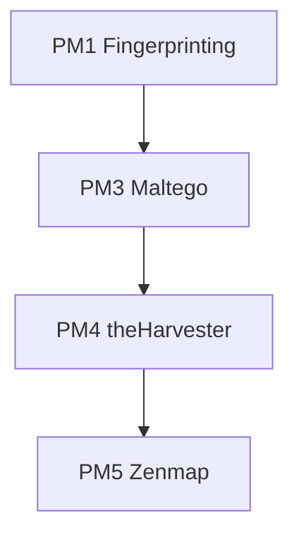

# 🔍 Footprinting, OSINT & Network Scanning
### Reconnaissance and discovery practicals using Kali Linux tools, Maltego, theHarvester and Zenmap

---

## 📌 Project Overview
This project documents the Week 2 practicals of the Networkwalks Cybersecurity Program (Batch B084). It follows the way an attacker moves through the first two phases of a penetration test: collecting public information about a target without touching it, correlating that information into a relationship graph, harvesting more data from public search engines, and finally discovering live hosts on a network segment.

Four practicals were completed:

| Module | Practical | Target / Scope |
| :--- | :--- | :--- |
| **W2-PM1** | Footprinting with six Kali Linux tools | `networkwalks.com` (written permission secured) |
| **W2-PM3** | Link analysis with Maltego | `networkwalks.com` (written permission secured) |
| **W2-PM4** | Passive OSINT with theHarvester | Public search-engine data (no direct contact with the target) |
| **W2-PM5** | Host discovery with Zenmap | My own local LAN (`10.0.1.0/24`) |

---

## 🎯 Objectives
- Collect domain registration, DNS, web-technology and perimeter-defence information about a target using six Kali Linux tools.
- Correlate a single domain into a graph of e-mail addresses, subdomains, mail servers and websites with Maltego.
- Harvest hostnames, IPs and email addresses from public sources with theHarvester.
- Identify the local subnet, discover live hosts, and capture IP and MAC addresses with Zenmap.
- Interpret every finding from an attacker's point of view and rate its risk.
- Recommend practical defensive improvements.
- Document commands, results, problems and lessons learned.

---

## 🛡️ Purpose of the Lab
These exercises build the skills used in the **Reconnaissance & Footprinting** and **Scanning & Network Discovery** phases of a penetration test.

Key capabilities practised:
- WHOIS and DNS intelligence gathering
- Web technology and WAF fingerprinting
- HTTP header analysis
- Link analysis and visual correlation of OSINT data
- Passive reconnaissance through search engines
- ARP/ICMP-based host discovery and topology mapping

---

## ⚙️ Environment & Tools

| 🧩 Component | ⚙️ Details |
| :--- | :--- |
| 🐉 Recon workstation | Kali Linux (`pentest-serv01`) |
| 🪟 Link analysis / scanning | Windows PC with Maltego Graph Desktop and Zenmap |
| 🔎 WHOIS | Domain registration data |
| 🌐 WhatWeb | Web technology fingerprinting |
| 📡 nslookup | DNS resolution (via 8.8.8.8) |
| 📥 curl | HTTP header inspection |
| 🧱 wafw00f v2.4.2 | WAF detection |
| 🗺️ dnsrecon | DNS enumeration |
| 🕸️ Maltego Graph 4.14.0 | Link analysis (Utilities transforms) |
| 🌾 theHarvester 4.11.1 | Passive OSINT |
| 🛰️ Zenmap / Nmap 7.99 | Host discovery and topology |
