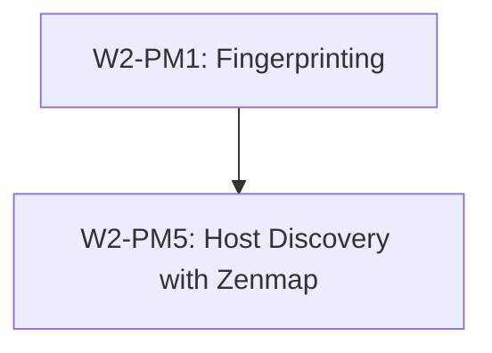
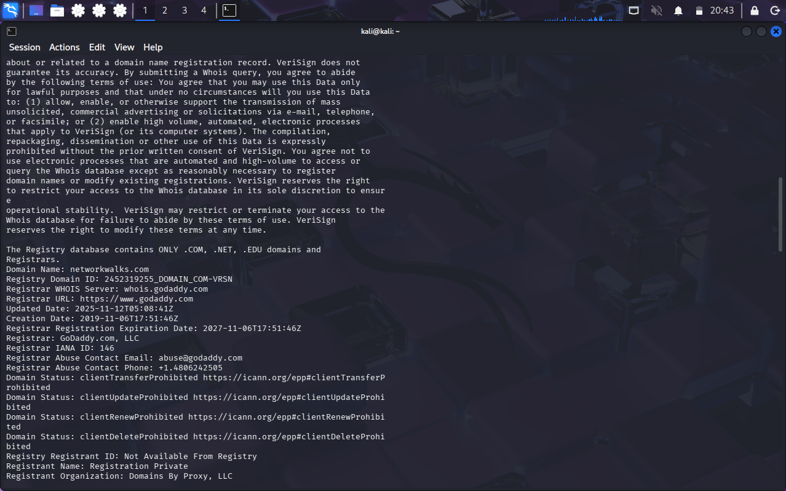
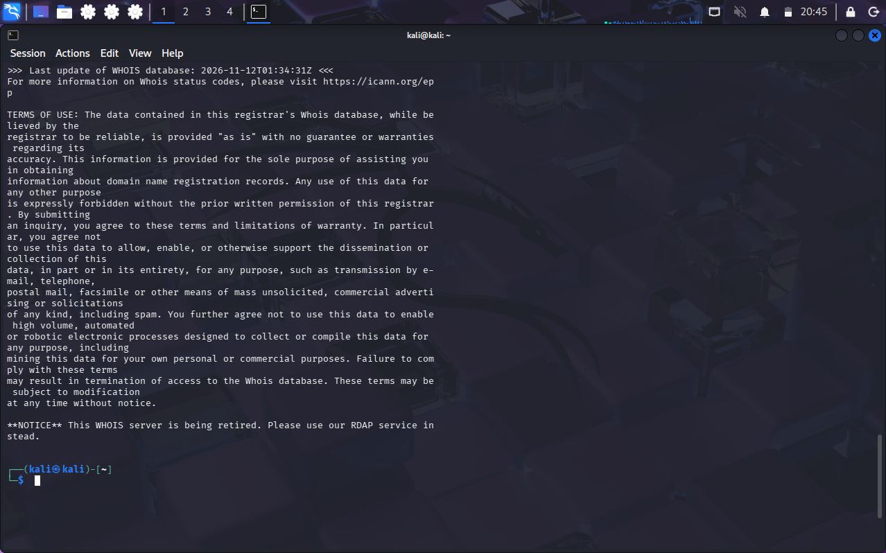
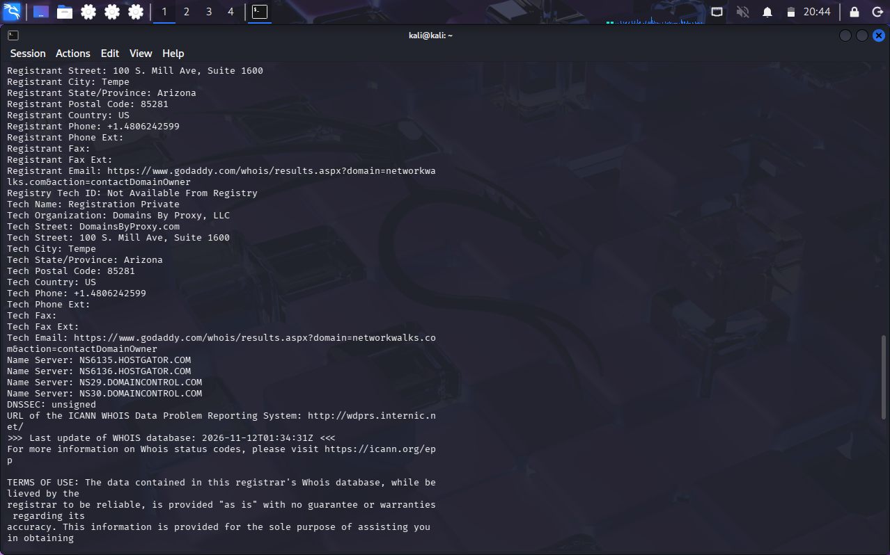
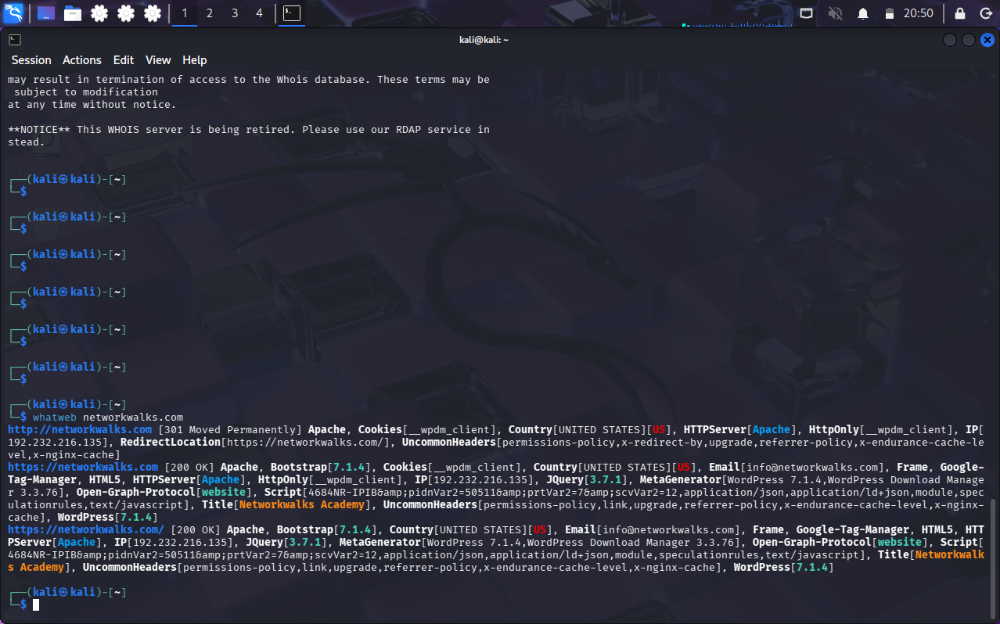
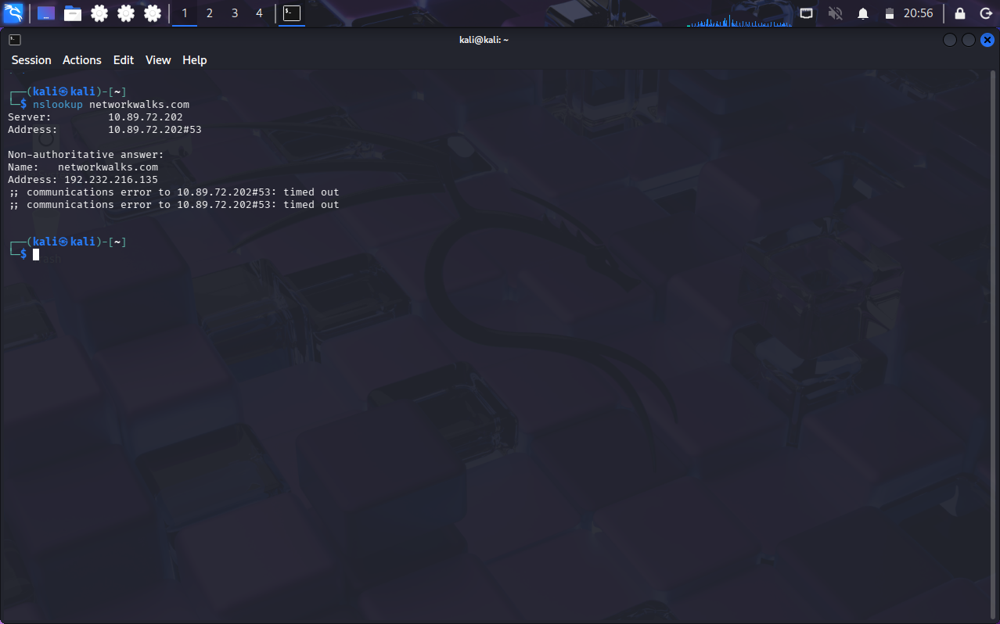
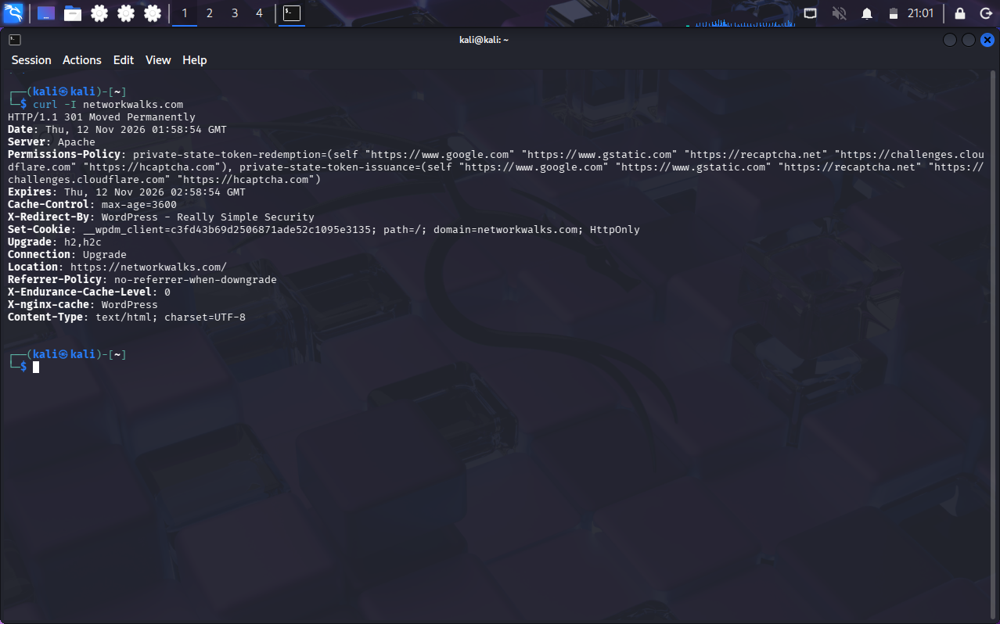
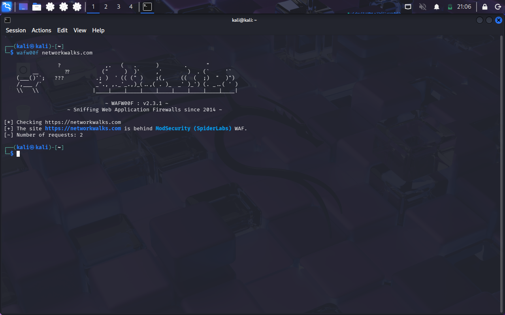
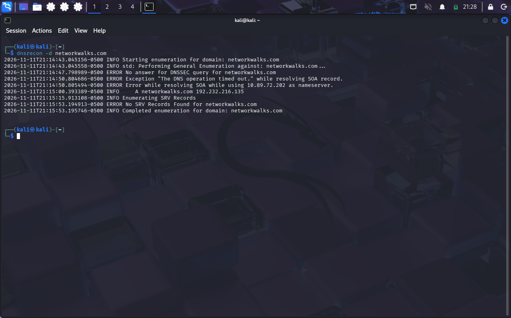

<div align="center">

# 🔍 Footprinting & Network Scanning
### Reconnaissance and discovery practicals using Kali Linux tools and Zenmap

[](https://github.com)
[](https://github.com)
[](https://github.com)
[](https://github.com)
[](https://github.com)
[](https://github.com)
[](https://github.com)

</div>

---

## 📌 Project Overview

This project covers selected practical exercises from Week 2 of the NetworkWalks Cybersecurity Program (Batch B084), focusing on Footprinting (PM1) and Host Discovery (PM5).

The footprinting exercise explores the use of six Kali Linux tools: WHOIS, WhatWeb, nslookup, curl, wafw00f, and dnsrecon. These tools are used to examine domain registration information, DNS records, web technologies, HTTP responses, and web application firewall configurations.

The host discovery exercise focuses on identifying active devices within a local network using Zenmap. It involves determining the local IP address and subnet, performing a network scan, and examining the discovered hosts and their available network information.

This repository presents the practical procedures, commands, findings, and screenshots from both exercises.

Two practicals were completed:

| Module | Practical | Target / Scope |
| :--- | :--- | :--- |
| **W2-PM1** | Footprinting with six Kali Linux tools | `networkwalks.com` (written permission secured) |
| **W2-PM5** | Host discovery with Zenmap | My own local LAN (`10.89.72.0/24`) |



---

## 🎯 Objectives

- Examine domain registration and DNS information using footprinting tools.
- Identify web technologies and WAF information.
- Analyse HTTP responses and DNS records.
- Identify the local network subnet using Windows network configuration.
- Discover active hosts on the local network using Zenmap.
- Document practical procedures, commands, findings, and screenshots.

---

## 🛡️ Purpose of the Lab
These exercises build the skills used in the **Reconnaissance & Footprinting** and **Scanning & Network Discovery** phases of a penetration test.

Key capabilities practised:
- WHOIS and DNS intelligence gathering
- Web technology and WAF fingerprinting
- Topology mapping

---

## ⚙️ Environment & Tools

| 🧩 Component | ⚙️ Details |
| :--- | :--- |
| 🐉 Recon workstation | Kali Linux (`pentest-serv01`) |
| 🔎 WHOIS | Domain registration data |
| 🌐 WhatWeb | Web technology fingerprinting |
| 📡 nslookup | DNS resolution (via 8.8.8.8) |
| 📥 curl | HTTP header inspection |
| 🧱 wafw00f v2.4.2 | WAF detection |
| 🗺️ dnsrecon | DNS enumeration |
| 🛰️ Zenmap / Nmap 7.99 | Host discovery and topology |

---

## Practical Execution and Findings

### WHOIS — Domain Registration Information

**Command:**
```bash
whois networkwalks.com
```

**Purpose:**

WHOIS was used to retrieve publicly available registration information about the target domain.

**Information examined:**
- Domain registrar.
- Domain creation and expiration dates.
- Domain status.
- Name servers.
- Registration privacy information.

**Findings and Analysis:**

The WHOIS lookup provided information about the domain's registration, registrar, name servers and registration status. This information helps establish the ownership and administrative details associated with a domain.

**Evidence:**






---

### WhatWeb — Web Technology Fingerprinting

**Command:**
```bash
whatweb networkwalks.com
```

**Purpose:**

WhatWeb was used to identify the technologies and software components running on the target website.

**Information examined:**
- Web server.
- Content Management System (CMS).
- JavaScript libraries.
- Website plugins.
- Server IP address.

**Findings and Analysis:**

The scan provided information about the website's underlying technologies and software components. Technology fingerprinting can help security professionals identify outdated software and understand the technologies used by a website.

**Evidence:**



---

### nslookup — DNS Information Gathering

**Command:**
```bash
nslookup networkwalks.com
```

**Purpose:**

nslookup was used to query the Domain Name System (DNS) and determine the IP address associated with the target domain.

**Information examined:**
- Domain name.
- Resolved IP address.
- DNS server used for the query.

**Findings and Analysis:**

The lookup returned the IP address associated with the domain. DNS information is useful during reconnaissance because it helps establish the relationship between domain names and their corresponding network addresses.

**Evidence:**



---

### curl — HTTP Header Inspection

**Command:**
```bash
curl -i networkwalks.com
```

**Purpose:**

curl was used to send an HTTP request and inspect the response returned by the target web server.

**Information examined:**
- HTTP response status.
- Server information.
- Redirect behaviour.
- Security-related HTTP headers.

**Findings and Analysis:**

The response provided information about how the web server handled the request, including its HTTP status and response headers. These headers can reveal details about the server configuration and security controls.

**Evidence:**



---

### wafw00f — Web Application Firewall Detection

**Command:**
```bash
wafw00f networkwalks.com
```

**Purpose:**

wafw00f was used to identify whether a Web Application Firewall (WAF) was protecting the target website.

**Information examined:**
- Presence of a WAF.
- Identified WAF technology.
- Detection response.

**Findings and Analysis:**

The tool examined the website's responses to determine whether a Web Application Firewall was present. Identifying a WAF helps security professionals understand the defensive technologies protecting a web application.

**Evidence:**



---

### dnsrecon — DNS Enumeration

**Command:**
```bash
dnsrecon -d networkwalks.com
```

**Purpose:**

dnsrecon was used to gather additional DNS information about the target domain.

**Information examined:**
- A records.
- MX records.
- NS records.
- SOA records.
- TXT records.
- Other available DNS information.

**Findings and Analysis:**

The enumeration provided additional information about the domain's DNS configuration and associated infrastructure. This information helps security professionals understand how a domain's DNS services are organised.

**Evidence:**



| Tool | Information Obtained |
|---|---|
| WHOIS | Domain registration information |
| WhatWeb | Website technologies |
| nslookup | Domain-to-IP resolution |
| curl | HTTP response and headers |
| wafw00f | WAF identification |
| dnsrecon | DNS records and infrastructure |

The results demonstrate how multiple reconnaissance tools can be combined to develop a better understanding of a domain's publicly exposed information.

---


## PM5: Network Scanning and Host Discovery Using Zenmap

### Practical Overview

This practical involved using Zenmap, the graphical user interface for Nmap, to perform network scanning and host discovery on my local network. The exercise focused on identifying active devices connected to the network, examining their IP and MAC addresses, and visualizing the discovered hosts.

### Objectives

- Identify the local IP address and network subnet.
- Perform host discovery using Zenmap.
- Identify active devices on the local network.
- Examine the IP and MAC addresses of discovered hosts.
- Generate a graphical network topology.

### Tools Used

- **Zenmap:** Graphical interface used to perform network scans.
- **Nmap:** Network discovery and scanning engine.
- **Windows Command Prompt:** Used to identify local network configuration.

### Identifying Local IP Address and Subnet

Before performing the scan, I used the `ipconfig` command in Windows Command Prompt to identify my laptop's network configuration.

**Command:**

```bash
ipconfig
```

**Network Information:**

- Local IPv4 Address: `10.89.72.212`
- Subnet Mask: `255.255.255.0`
- Network Subnet: `10.89.72.0/24`


### Performing Host Discovery Using Zenmap

I opened Zenmap and entered my local network subnet into the Target field.

The following command was used for host discovery:

```bash
nmap -sn 10.89.72.0/24
```

The `-sn` option performs host discovery without conducting a port scan. It helps identify which devices are active on the specified network.

After entering the target and selecting the appropriate scan profile, I initiated the scan and allowed Zenmap to discover the active hosts.

**Screenshot:**


### Scan Results and Findings

After the scan was completed, Zenmap displayed the hosts discovered on my local network.

**Scan Summary:**

- Network Scanned: `10.89.72.0/24`
- Total Live Hosts: `2`

**Discovered Hosts:**

| S/N | IP Address | MAC Address |
|---|---|---|
| 1 | `10.89.72.202` | `36:52:8D:02:D1:6F` |
| 2 | `10.89.72.212` | `Not available` |


### Network Topology Visualization

Zenmap's topology feature was used to visualize the discovered hosts on the network. This provided a graphical representation of the scan results and helped illustrate the devices identified during host discovery.

**Screenshot:**


### Conclusion

This practical provided hands-on experience with network scanning and host discovery using Zenmap. I learned how to identify my local IP address and network subnet, perform host discovery, identify active devices, examine their IP and MAC addresses, and visualize the discovered network topology.

The exercise improved my understanding of basic network reconnaissance and the use of Nmap for identifying devices on a local network.

---

##  Documentation
Findings are only useful when they are clearly documented: what was done, what was seen, why it matters, and how to reduce the risk.

📄 **Full report:** [W2-PM-FINAL Penetration Testing Report (PDF)](W2-PM-Report.pdf)

## 👤 Author
**Adebusola Henry**
* Network Operations Center & Cybersecurity
* Networkwalks Cybersecurity Program (Batch B084)
* **LinkedIn:** [https://www.linkedin.com/in/adebusola-henry-5a009a372/](https://www.linkedin.com/in/adebusola-henry-5a009a372/)

